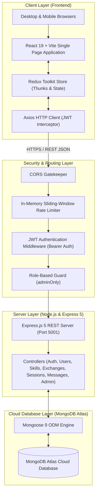
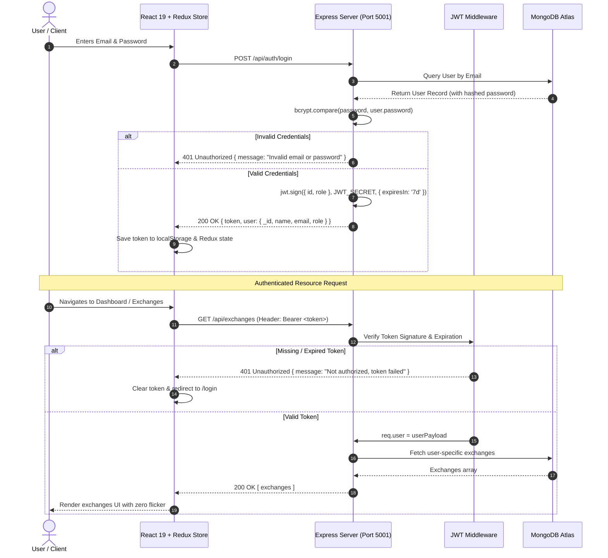
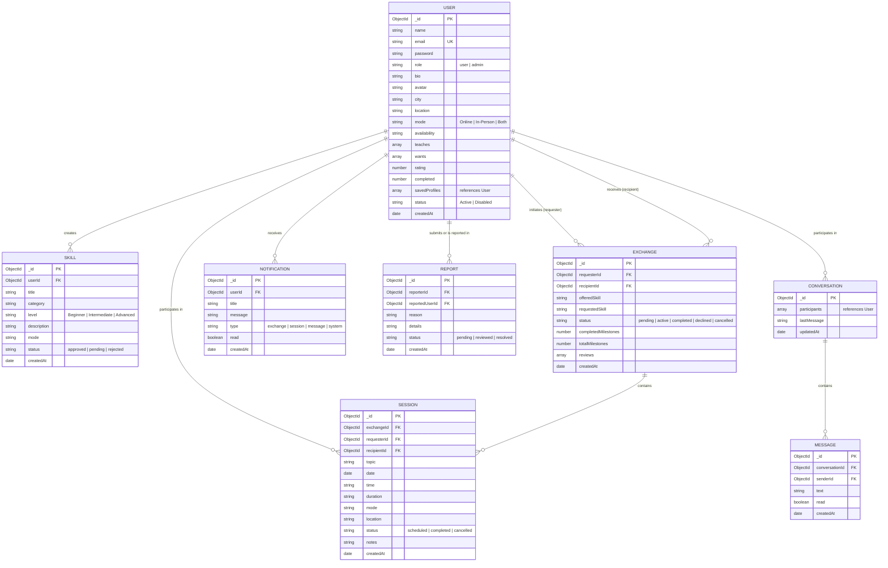

# SKILLBRIDGE — Peer-to-Peer Skill Exchange Platform

> **Learn a Skill. Share a Skill. Grow Together.**  
> A complete, production-ready, full-stack MERN application connecting peer learners for structured, mutual skill swaps without monetary barriers.

[](https://skillbridge-six-olive.vercel.app)
[](https://nodejs.org/)
[](https://react.dev/)
[](https://tailwindcss.com/)
[](https://www.mongodb.com/atlas)
[](LICENSE)

---

## 1. Executive Summary & Problem Statement

In today's digital economy, acquiring high-leverage skills—such as software engineering, UI/UX design, foreign languages, and digital marketing—is frequently gated behind expensive bootcamps, paywalled subscriptions, or impersonal video courses. Traditional education systems lack accessible, one-on-one personalized mentorship.

Conversely, millions of talented individuals possess domain expertise and are eager to learn complementary abilities. A frontend developer may want to learn conversational German, while a German teacher wants to build their portfolio website. 

**SKILLBRIDGE** eliminates the financial barrier by implementing a decentralized, peer-to-peer knowledge marketplace. Instead of currency, learning partners trade time, mentorship, and practical guidance through structured skill exchanges, milestone tracking, and verified peer reviews.

---

## 2. Solution & Core Value Proposition

SKILLBRIDGE provides an end-to-end ecosystem where users can:
1. **Catalog Domain Knowledge:** List skills offered (`teaches`) alongside target skills (`wants`) with proficiency levels and instructional modes.
2. **Discover Compatible Partners:** Utilize a deterministic Smart Match Algorithm that calculates bidirectional compatibility scores.
3. **Formalize Agreements:** Initiate, negotiate, and accept structured 1-on-1 skill exchange agreements with clearly defined terms.
4. **Schedule & Track Sessions:** Organize virtual or in-person sessions with date, time, duration, and milestone progress.
5. **Real-Time Communication:** Coordinate sessions and swap learning resources via dedicated direct messaging channels.
6. **Build Trust & Reputation:** Build public credibility with verified ratings, reviews, and completed exchange counters.
7. **Platform Moderation:** Administrators oversee platform safety via user status management, listing approvals, and content moderation reports.

---

## 3. High-Level Architecture & Data Flow

SKILLBRIDGE is architected following the **MERN (MongoDB Atlas, Express.js, React 19, Node.js)** pattern with decoupled client-server communications over RESTful JSON APIs secured via JSON Web Tokens (JWT).



---

## 4. Authentication & Security Flow

All private interactions require a standard `Authorization: Bearer <token>` header. Passwords are cryptographically salted and hashed using `bcryptjs` with 10 salt rounds.



---

## 5. Smart Match Scoring Algorithm

The platform features an intelligent, bidirectional matching engine located at `backend/utils/matchAlgorithm.js` and `src/utils/matchAlgorithm.js`. It dynamically assigns a compatibility percentage (0% to 100%) between any two users based on three weighted criteria:

1. **Bidirectional Skill Swaps (50% weight):**
   - User A teaches a skill User B wants.
   - User B teaches a skill User A wants.
   - Substring and case-insensitive matching allows fuzzy matches (e.g., `"Python"` matches `"Python 3"` or `"Data Science with Python"`).
2. **Category Cross-Alignment (30% weight):**
   - Matches between broad disciplines (e.g., Tech, Design, Language, Music, Business).
3. **Reputation & Reliability Factor (20% weight):**
   - User rating (normalized 1.0–5.0) and completed session count add bonus points to incentivize reliable community members.

$$\text{Match Score} = \min\left(100, (\text{MutualSkillMatches} \times 50) + (\text{CategoryMatches} \times 30) + (\text{ReputationBonus} \times 20)\right)$$

Users with a score $\ge 70\%$ receive the **"High Match"** visual badge on community cards.

---

## 6. Database Entity-Relationship (ER) Schema

SKILLBRIDGE utilizes MongoDB Atlas with Mongoose ODM. Schemas are fully normalized with relational `ObjectId` references and indexed fields for query performance.



---

## 7. Technology Stack

### Frontend
- **Framework:** React 19 (`19.2.6`)
- **Build Tool:** Vite (`7.3.2`) with `@vitejs/plugin-react`
- **Styling:** Tailwind CSS 4 (`@tailwindcss/vite` 4.1.17)
- **State Management:** Redux Toolkit (`2.13.0`) + React-Redux (`9.3.1`)
  - Features dual-layer state management: asynchronous API dispatches paired with persistent local storage caching for immediate, flicker-free rendering.
- **Routing:** React Router DOM (`7.18.5`)
- **HTTP Client:** Axios (`1.21.1`) configured with automatic `Bearer` JWT authorization interceptors and timeout protections.
- **Icons:** React Icons (`5.7.0` - Feather Icons)

### Backend
- **Runtime:** Node.js (v18+ / v20+ / v22+)
- **Server Framework:** Express.js 5 (`5.3.0`)
- **Database:** MongoDB Atlas (Mongoose `9.12.2` ODM)
- **Authentication:** JSON Web Tokens (`jsonwebtoken` 9.0.3)
- **Password Hashing:** `bcryptjs` (3.0.3) with 10 salt rounds
- **Security & Rate Limiting:**
  - Strict Cross-Origin Resource Sharing (`cors` 2.8.6)
  - In-memory sliding-window rate limiter protecting auth routes against brute-force attacks
  - Role-based route guard (`adminOnly`)
- **Environment Management:** `dotenv` (`18.0.10`)

---

## 8. Complete Project Directory Structure

```text
SKILLBRIDGE/
├── .gitignore                                 # Root Git exclusions
├── index.html                                 # HTML5 entry template
├── package.json                               # Frontend scripts & dependencies
├── package-lock.json                          # Pinned dependency lockfile
├── tsconfig.json                              # TypeScript & JSX compilation config
├── tsconfig.node.json                         # Node TypeScript config
├── vite.config.ts                             # Vite build configuration
│
├── backend/                                   # Express.js REST API
│   ├── .gitignore                             # Backend Git exclusions
│   ├── package.json                           # Backend scripts & dependencies
│   ├── server.js                              # Express server entry point & middleware setup
│   ├── config/
│   │   └── db.js                              # MongoDB Atlas connection handler
│   ├── controllers/
│   │   ├── adminController.js                 # Admin moderation, reports, user status
│   │   ├── authController.js                  # Register, login, admin authentication
│   │   ├── exchangeController.js              # Skill swaps, agreements, reviews
│   │   ├── messageController.js               # Chat channels & direct messaging
│   │   ├── notificationController.js          # Activity & system alerts
│   │   ├── sessionController.js               # Learning sessions scheduling & milestones
│   │   ├── skillController.js                 # Skill listings CRUD
│   │   └── userController.js                  # User profile, password, bookmarks
│   ├── middleware/
│   │   ├── authMiddleware.js                  # JWT verification & adminOnly guard
│   │   └── rateLimiter.js                     # Sliding-window brute-force rate limiter
│   ├── models/
│   │   ├── Conversation.js                    # Messaging thread schema
│   │   ├── Exchange.js                        # Skill exchange agreement schema
│   │   ├── Message.js                         # Direct message schema
│   │   ├── Notification.js                    # User notification schema
│   │   ├── Report.js                          # Moderation report schema
│   │   ├── Session.js                         # Learning session schema
│   │   ├── Skill.js                           # Skill listing schema
│   │   └── User.js                            # User profile & credentials schema
│   ├── routes/
│   │   ├── adminRoutes.js                     # /api/admin endpoints
│   │   ├── authRoutes.js                      # /api/auth endpoints
│   │   ├── exchangeRoutes.js                  # /api/exchanges endpoints
│   │   ├── messageRoutes.js                   # /api/messages endpoints
│   │   ├── notificationRoutes.js              # /api/notifications endpoints
│   │   ├── sessionRoutes.js                   # /api/sessions endpoints
│   │   ├── skillRoutes.js                     # /api/skills endpoints
│   │   └── userRoutes.js                      # /api/users endpoints
│   └── utils/
│       ├── matchAlgorithm.js                  # Server-side matching algorithm
│       └── seedData.js                        # Database initialization & default admin seeder
│
└── src/                                       # React 19 Frontend
    ├── App.tsx                                # Route configuration & layout nesting
    ├── main.tsx                               # DOM mount & Redux Provider setup
    ├── api/
    │   └── client.js                          # Axios instance with JWT auth interceptor
    ├── components/
    │   ├── AdminLayout.jsx                    # Admin navigation & sidebar wrapper
    │   ├── DashboardLayout.jsx                # User dashboard navigation & sidebar
    │   ├── ExchangeCard.jsx                   # Exchange card component
    │   ├── ExchangeRequestModal.jsx           # Request swap modal with match preview
    │   ├── Footer.jsx                         # Platform footer
    │   ├── HeroDoodles.jsx                    # Interactive hand-drawn hero SVG doodles
    │   ├── Navbar.jsx                         # Main responsive top navigation bar
    │   ├── ProfileCard.jsx                    # Peer profile card with skills & badges
    │   ├── ProtectedRoute.jsx                 # User route guard
    │   ├── ReviewModal.jsx                    # Rating & review submission modal
    │   └── ScheduleSessionModal.jsx           # Date/time session scheduling modal
    ├── data/
    │   └── defaultData.js                     # Default categories, skills & fallback fixtures
    ├── pages/
    │   ├── About.jsx                          # Mission & community story page
    │   ├── Contact.jsx                        # Contact support & inquiry page
    │   ├── Faq.jsx                            # Frequently asked questions
    │   ├── Home.jsx                           # Landing page with hero, doodles, & CTA
    │   ├── HowItWorks.jsx                     # Educational step-by-step swap guide
    │   ├── Login.jsx                          # User authentication page
    │   ├── Register.jsx                       # User onboarding page with skill tags
    │   ├── admin/
    │   │   ├── AdminDashboard.jsx             # Admin analytics & key platform metrics
    │   │   ├── AdminLogin.jsx                 # Dedicated administrator login
    │   │   ├── Reports.jsx                    # Moderation & dispute handling
    │   │   ├── SkillListings.jsx              # Community listing review & approval
    │   │   └── Users.jsx                      # User account status management & ban controls
    │   └── dashboard/
    │       ├── Dashboard.jsx                  # Main user portal & overview
    │       ├── Discover.jsx                   # Search, filter & match peer directory
    │       ├── ExchangeDetails.jsx            # Agreement milestones & session logs
    │       ├── Exchanges.jsx                  # Active, pending, & completed swap lists
    │       ├── Messages.jsx                   # Real-time chat & discussion threads
    │       ├── MyProfile.jsx                  # Profile editor, image upload & skill tags
    │       ├── Notifications.jsx              # User notification center
    │       ├── Profile.jsx                    # Public view of other members' profiles
    │       ├── SavedProfiles.jsx              # Bookmarked learning partners
    │       ├── Sessions.jsx                   # Scheduled learning sessions calendar
    │       ├── Settings.jsx                   # Password change & account deletion
    │       └── ShareSkill.jsx                 # Publish new skill listing page
    ├── redux/
    │   ├── store.js                           # Centralized Redux store configuration
    │   └── slices/
    │       ├── adminSlice.js                  # Admin metrics, user toggle & report state
    │       ├── exchangeSlice.js               # Exchanges async thunks & CRUD state
    │       ├── messageSlice.js                # Conversations & message send state
    │       ├── notificationSlice.js           # Read status & notification triggers
    │       ├── savedSlice.js                  # Bookmarked profiles state
    │       ├── sessionSlice.js                # Session scheduling & status state
    │       ├── skillSlice.js                  # Skill listings state
    │       └── userSlice.js                   # Auth, profile, password & status state
    ├── styles/
    │   ├── index.css                          # Tailwind CSS imports & custom variables
    │   └── theme.css                          # Color variables, doodle strokes & font tokens
    └── utils/
        ├── matchAlgorithm.js                  # Client-side match calculation
        └── socialIcons.jsx                    # Social media icon mapper
```

---

## 9. Complete REST API Endpoints Reference

The backend provides **41 endpoints** across 8 resource modules:

| # | HTTP Method | Endpoint | Auth | Role | Description |
|---|---|---|---|---|---|
| **0** | **Health Checks** | | | | |
| 1 | `GET` | `/` | None | Public | Root welcome message and API status |
| 2 | `GET` | `/api/health` | None | Public | Server uptime and MongoDB connection state |
| **1** | **Authentication** | | | | |
| 3 | `POST` | `/api/auth/register` | None | Public | Register new user account with initial skills |
| 4 | `POST` | `/api/auth/login` | None | Public | Authenticate user & receive JWT token |
| 5 | `POST` | `/api/auth/admin/login` | None | Admin | Authenticate platform administrator |
| 6 | `GET` | `/api/auth/me` | Bearer | User/Admin | Retrieve current authenticated session identity |
| **2** | **Users & Profiles** | | | | |
| 7 | `GET` | `/api/users` | Optional | Public/User | Browse community users with search & filters |
| 8 | `GET` | `/api/users/recommended` | Bearer | User | Smart matching recommendations for current user |
| 9 | `GET` | `/api/users/saved` | Bearer | User | Retrieve bookmarked user profiles |
| 10 | `POST` | `/api/users/saved/:id` | Bearer | User | Toggle bookmark/save for a profile |
| 11 | `PUT` | `/api/users/profile` | Bearer | User | Update personal profile details and skills |
| 12 | `PUT` | `/api/users/change-password` | Bearer | User | Change password (verifies current password) |
| 13 | `DELETE` | `/api/users/account` | Bearer | User | Permanently delete own user account |
| 14 | `GET` | `/api/users/:id` | Optional | Public/User | Get full public profile of a user by ID |
| **3** | **Skill Listings** | | | | |
| 15 | `GET` | `/api/skills` | None | Public | Retrieve all approved skill offerings |
| 16 | `POST` | `/api/skills` | Bearer | User | Publish a new skill listing (sets pending/approved) |
| 17 | `PUT` | `/api/skills/:id` | Bearer | Owner | Update an existing skill listing |
| 18 | `DELETE` | `/api/skills/:id` | Bearer | Owner/Admin | Remove a skill listing |
| **4** | **Skill Exchanges** | | | | |
| 19 | `GET` | `/api/exchanges` | Bearer | User | Retrieve all exchanges for authenticated user |
| 20 | `POST` | `/api/exchanges` | Bearer | User | Initiate a new skill swap proposal |
| 21 | `GET` | `/api/exchanges/:id` | Bearer | Participant | Get detailed view of an exchange agreement |
| 22 | `PATCH` | `/api/exchanges/:id/status` | Bearer | Recipient | Accept, decline, or cancel an exchange |
| 23 | `PATCH` | `/api/exchanges/:id/milestone`| Bearer | Participant | Increment completed milestones |
| 24 | `POST` | `/api/exchanges/:id/reviews` | Bearer | Participant | Submit 1–5 star rating & feedback review |
| **5** | **Learning Sessions** | | | | |
| 25 | `GET` | `/api/sessions` | Bearer | Participant | Get all scheduled sessions for user |
| 26 | `POST` | `/api/sessions` | Bearer | Participant | Schedule a new 1-on-1 session |
| 27 | `PUT` | `/api/sessions/:id` | Bearer | Participant | Update/reschedule an existing session |
| 28 | `PATCH` | `/api/sessions/:id/complete` | Bearer | Participant | Mark session as successfully completed |
| 29 | `DELETE` | `/api/sessions/:id` | Bearer | Participant | Cancel a scheduled session |
| **6** | **Messages & Chat** | | | | |
| 30 | `GET` | `/api/messages/conversations` | Bearer | Participant | Get active messaging threads |
| 31 | `GET` | `/api/messages/:conversationId`| Bearer | Participant | Get message history for a conversation |
| 32 | `POST` | `/api/messages` | Bearer | Participant | Send a message to another user |
| **7** | **Notifications** | | | | |
| 33 | `GET` | `/api/notifications` | Bearer | User | Retrieve recent platform notifications |
| 34 | `PATCH` | `/api/notifications/:id/read` | Bearer | User | Mark single notification as read |
| 35 | `PATCH` | `/api/notifications/read-all` | Bearer | User | Mark all user notifications as read |
| **8** | **Admin Operations** | | | | |
| 36 | `GET` | `/api/admin/stats` | Bearer | Admin | Aggregate statistics (users, skills, exchanges) |
| 37 | `GET` | `/api/admin/users` | Bearer | Admin | List all registered platform users |
| 38 | `PATCH` | `/api/admin/users/:id/toggle-status` | Bearer | Admin | Toggle user active/disabled status |
| 39 | `DELETE` | `/api/admin/users/:id` | Bearer | Admin | Permanently delete user account |
| 40 | `GET` | `/api/admin/skills` | Bearer | Admin | List all submitted skill listings |
| 41 | `PATCH` | `/api/admin/skills/:id/approve` | Bearer | Admin | Approve or reject a skill listing |
| 42 | `DELETE` | `/api/admin/skills/:id` | Bearer | Admin | Remove inappropriate skill listing |
| 43 | `GET` | `/api/admin/reports` | Bearer | Admin | List community moderation reports |
| 44 | `POST` | `/api/admin/reports` | Bearer | User | File a moderation report against a user |
| 45 | `PATCH` | `/api/admin/reports/:id/resolve` | Bearer | Admin | Resolve or dismiss a moderation report |

---

## 10. Local Installation & Setup

### Prerequisites
- **Node.js:** v18.0.0 or higher (v20+ recommended)
- **npm:** v9.0.0 or higher
- **MongoDB Atlas Account:** A free cluster at [cloud.mongodb.com](https://www.mongodb.com/atlas) (or local MongoDB instance).

### Step 1: Clone the Repository
```bash
git clone https://github.com/Mebii22/SKILLBRIDGE.git
cd SKILLBRIDGE
```

### Step 2: Install Dependencies
Install frontend and backend dependencies:
```bash
# Install root (frontend) dependencies
npm install

# Install backend dependencies
cd backend && npm install && cd ..
```
*(Or use the convenience script: `npm run install:all`)*

### Step 3: Manual Environment Configuration

Create the environment files manually on your machine:

1. **Frontend Configuration (`.env` in the root folder):**
   ```env
   VITE_API_URL=http://localhost:5001/api
   ```

2. **Backend Configuration (`backend/.env`):**
   ```env
   PORT=5001
   NODE_ENV=development
   MONGO_URI=mongodb+srv://<username>:<password>@<cluster>.mongodb.net/skillbridge_db?retryWrites=true&w=majority
   JWT_SECRET=your_super_secret_jwt_key_here
   CLIENT_URL=http://localhost:5173
   ADMIN_EMAIL=admin@skillbridge.com
   ADMIN_PASSWORD=your_secure_admin_password_here
   ```

| Variable | Scope | Purpose |
|---|---|---|
| `VITE_API_URL` | Frontend | Target Express REST API endpoint URL |
| `PORT` | Backend | Port number for Express server (default `5001`) |
| `NODE_ENV` | Backend | Application environment mode (`development` or `production`) |
| `MONGO_URI` | Backend | MongoDB Atlas cluster connection string with credentials |
| `JWT_SECRET` | Backend | Cryptographic secret key used to sign and verify JWT tokens |
| `CLIENT_URL` | Backend | Whitelisted frontend origin for CORS policies |
| `ADMIN_EMAIL` | Backend | Default administrator account email |
| `ADMIN_PASSWORD` | Backend | Default administrator initial seed password |

> [!NOTE]
> Replace `<username>` and `<password>` with your actual MongoDB Atlas database user credentials. Environment files are strictly excluded from version control via `.gitignore`.

### Step 4: Start the Application

Run both servers concurrently in separate terminal sessions:

**Terminal 1 (Backend Server):**
```bash
npm run server
# Server initializes on http://localhost:5001
# Automatically verifies MongoDB Atlas connection and seeds admin
```

**Terminal 2 (Frontend Client):**
```bash
npm run dev
# Vite development server starts on http://localhost:5173
```

Open your browser and navigate to `http://localhost:5173`.

---

## 11. MongoDB Atlas Configuration Guide

1. Log into your [MongoDB Atlas Console](https://cloud.mongodb.com/).
2. Create or select a **Shared (M0 Free)** Cluster.
3. Under **Security → Database Access**:
   - Create a database user (e.g., `skillbridge_user`).
   - Assign the **Read and write to any database** built-in role.
   - Securely save the generated password.
4. Under **Security → Network Access**:
   - Add an IP access list entry.
   - For local development and serverless deployment, select **Allow Access from Anywhere (`0.0.0.0/0`)**.
5. Under **Deployment → Database → Connect**:
   - Select **Drivers** (Node.js).
   - Copy the connection string into `backend/.env` as `MONGO_URI`.

---

## 12. Manual Production Deployment Guide

### Frontend Deployment (Vercel)
The client application is deployed on Vercel at:
**[https://skillbridge-six-olive.vercel.app](https://skillbridge-six-olive.vercel.app)**

To deploy to Vercel:
1. Push your repository to GitHub.
2. Import the project into the [Vercel Dashboard](https://vercel.com).
3. Set the build configuration:
   - **Framework Preset:** Vite
   - **Build Command:** `npm run build`
   - **Output Directory:** `dist`
4. Configure Environment Variables:
   - `VITE_API_URL`: URL of your deployed backend (e.g. `https://your-api-domain.com/api`).
5. Click **Deploy**.

### Backend Deployment (Cloud Hosting)
The backend is a standard Node.js Express server ready for deployment on any cloud hosting platform (e.g., Render, Railway, AWS, DigitalOcean):

1. Set the **Root Directory** to `backend`.
2. Configure the build command: `npm install`.
3. Configure the start command: `node server.js`.
4. Add the required environment variables:
   - `PORT`: `5001`
   - `NODE_ENV`: `production`
   - `MONGO_URI`: Your MongoDB Atlas connection string
   - `JWT_SECRET`: Your production JWT secret key
   - `CLIENT_URL`: URL of your deployed frontend (e.g., `https://skillbridge-six-olive.vercel.app`)
5. Deploy service and verify the `/api/health` endpoint responds with `{ status: "ok" }`.

---

## 13. Security, Moderation & Performance Hardening

1. **Password Encryption:** Zero plain-text storage. Passwords are irreversibly hashed using `bcryptjs` with 10 salt rounds before persistence.
2. **Brute-Force Rate Limiting:** Auth routes (`/register`, `/login`, `/admin/login`) are protected by an in-memory sliding-window rate limiter restricting repeated failed attempts.
3. **Role Escalation Protection:** The registration endpoint hardcodes `role: "user"`. Admin accounts cannot be created via public registration and require administrative credentials.
4. **JWT Verification:** All state-modifying requests require signed JWTs passed through the `Authorization` header. Expired or tampered tokens are rejected with `401 Unauthorized`.
5. **CORS Whitelisting:** Dynamic CORS policies restrict incoming cross-origin API calls to approved origins (`CLIENT_URL` and `localhost`).
6. **Payload Sanitization & Size Limits:** `express.json` is configured with a 10MB payload threshold to facilitate base64 profile picture uploads while preventing denial-of-service memory exhaustion.
7. **Zero UI Redesign Policy:** Strict preservation of original Tailwind CSS styles, layout, and visual doodles while integrating full backend data persistence.

---

## 14. Quality Assurance & Static Verification

The codebase has undergone complete static verification and builds cleanly:

- **TypeScript Type Verification:**
  ```bash
  npx tsc --noEmit
  # Result: 0 errors
  ```
- **Vite Production Bundler:**
  ```bash
  npm run build
  # Result: built in ~700ms, 0 errors, single-bundle distribution generated
  ```
- **Backend Node.js Syntax Verification:**
  ```bash
  find backend -name "*.js" -not -path '*/node_modules/*' -exec node --check {} +
  # Result: All 21 backend files parsed with 0 syntax errors
  ```

---

## 15. Academic Accreditation & Author

This platform was designed, engineered, and documented as the **Final Capstone Project** for the **ME(A)RN Stack Development** curriculum at **Luminar Technolab**.

- **Lead Architect & Developer:** Antony Mebin K.
- **GitHub:** [@Mebii22](https://github.com/Mebii22)
- **Repository:** [https://github.com/Mebii22/SKILLBRIDGE](https://github.com/Mebii22/SKILLBRIDGE)
- **Live Demo:** [https://skillbridge-six-olive.vercel.app](https://skillbridge-six-olive.vercel.app)

---

## 16. License

This project is licensed under the [MIT License](LICENSE) — free for educational and collaborative open-source use.
